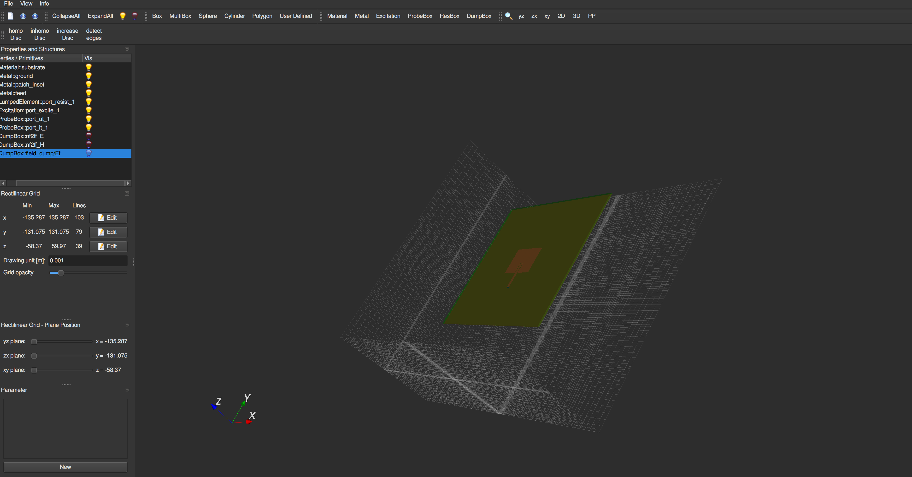
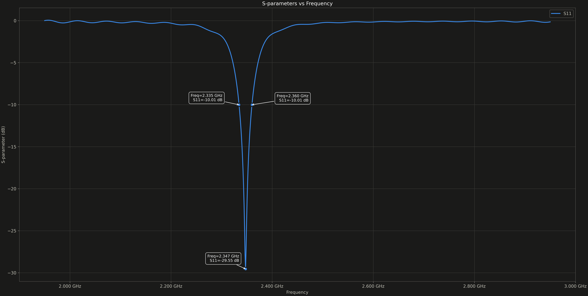
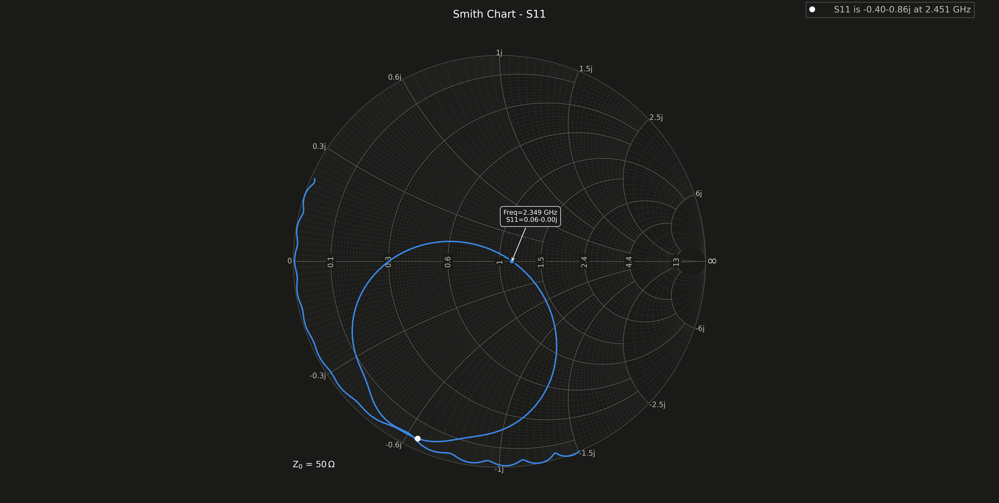
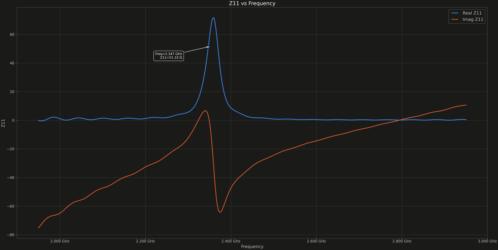
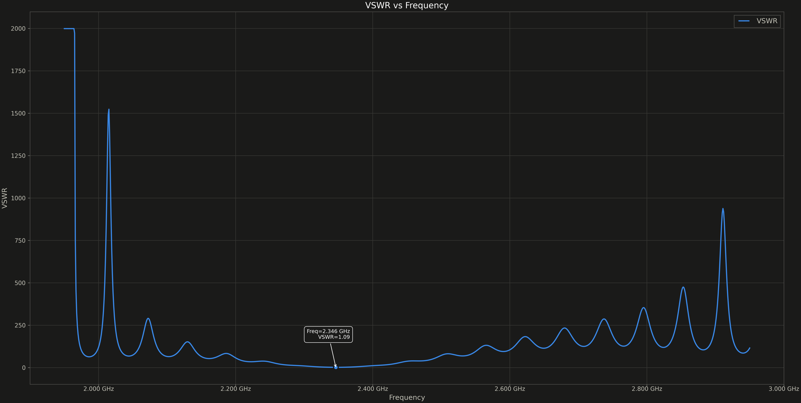
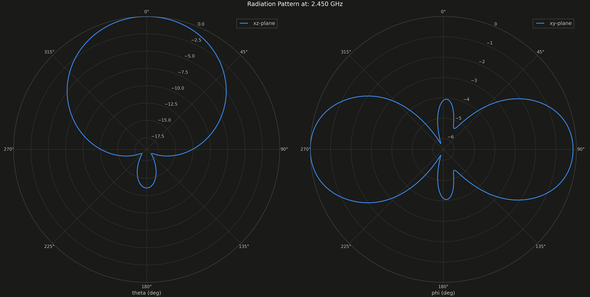
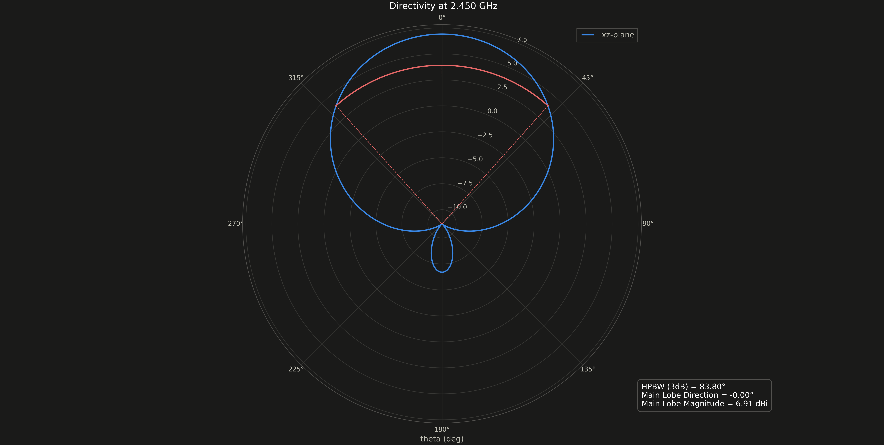
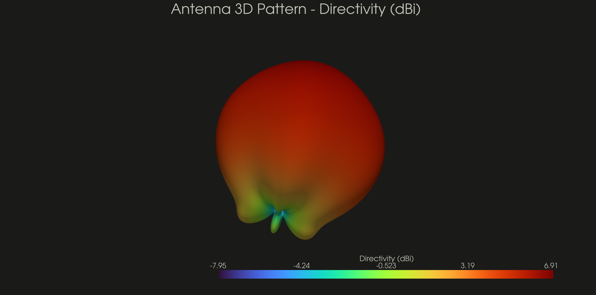
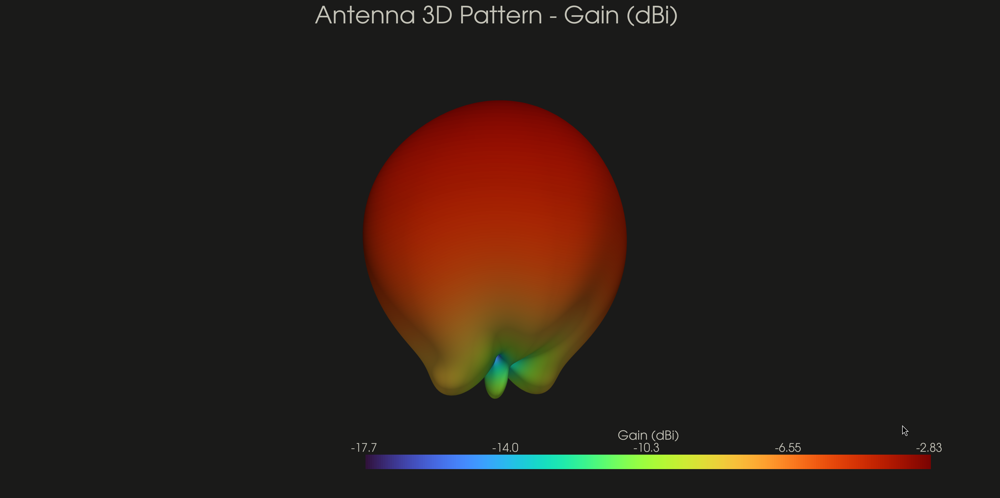

<p align="center">
  
</p>

[](https://www.gnu.org/licenses/agpl-3.0)
[](https://pypi.org/project/simpleEMS/)
[](https://www.python.org)

simpleEMS is a Python library built on top of [openEMS](https://openems.readthedocs.io/en/latest/)
that makes designing and simulating antennas and other RF and microwave structures simpler.
You give it a target frequency and a substrate; it derives the dimensions, builds the
geometry, meshes it, runs the solver and plots the results.

## Table of Contents

- [Motivation](#motivation)
- [Structures](#structures)
- [Features](#features)
  - [Simulation and Optimization](#simulation-and-optimization)
  - [Network Parameters](#network-parameters)
  - [Plots](#plots)
  - [Far Field](#far-field)
  - [Field Dumps](#field-dumps)
  - [Export](#export)
  - [Design Report](#design-report)
- [Solver Backends](#solver-backends)
- [Installation](#installation)
- [Demo](#demo)
- [Documentation](#documentation)
- [License](#license)

## Motivation

simpleEMS is a free alternative to proprietary suites with expensive licenses, and to the
"Student" editions of CST, HFSS and Sonnet that cap the mesh size and memory. It builds on
the openEMS FDTD engine and adds an experimental FEM backend, so you can simulate,
optimize and visualize RF designs without those limits, whether you are a professional
engineer, a freelancer or a hobbyist.

## Structures

Pick a structure, give it the frequency you want, and simpleEMS works out its
dimensions for you.

**Antennas**
- Inset-fed patch antenna
- Probe-fed patch antenna
- Inverted-F antenna (IFA)
- Printed dipole antenna
- Printed monopole antenna

**Filters**
- Band-pass quarter-wave stub filter
- Band-stop quarter-wave stub filter

**Couplers**
- 3 dB branch-line hybrid coupler

**Transmission lines**
- Microstrip line

**Your own design**
- Build a custom structure from ready-made pieces such as traces, bends, tapers, stubs
  and vias
- Simulate a model you drew in another tool, from a STEP file or an openEMS XML file

## Features

### Simulation and Optimization
- Automatic FDTD meshing from the geometry, with graded cells and the thirds rule
- Parameter sweeps
- S11, S21 and multi-port S-parameter optimization

### Network Parameters
- S-parameters: S11 (reflection) and S21 (transmission), or the full S-matrix of a
  multi-port network
- VSWR
- Input impedance (Z11)
- Input power

### Plots
- 3D structure preview
- S-parameter magnitude, phase and group delay
- VSWR
- Input impedance
- Smith chart
- Dark and light plot themes

### Far Field
- 2D radiation pattern
- 2D directivity and 2D realized gain, in polar and Cartesian views
- 3D directivity and 3D realized gain
- Radiation and total efficiency against frequency, in percent and dB

### Field Dumps
- E-field, H-field and current density for ParaView
- Time and frequency domain under FDTD; frequency domain under FEM

### Export
- Gerber: one file per copper layer, an Excellon drill file and a board outline
- STEP (AP242) and STL
- Touchstone (`.sNp`), including every S-parameter of a multi-port network

### Design Report
- A PDF report that explains the design to its readers: the design
  target, key results, the copper layout with its ports and dimensions, the S-parameters,
  VSWR, impedance, Smith chart and, with far-field data, the radiation pattern and
  efficiency

## Solver Backends

You pick the solver with `sim_method` on your sim params:

- **FDTD** (default): the time-domain solver, powered by
  [openEMS](https://openems.readthedocs.io/en/latest/). Pass `openems_engine` to
  `run_simulation` to pick the openEMS engine, such as `"multithreaded"`; the
  default, `"fastest"`, lets openEMS choose.
- **FEM** *(experimental)*: a frequency-domain finite-element solver, powered by
  [Gmsh](https://gmsh.info) and [GetDP](https://getdp.info). It offers lumped ports or a
  wave port, open (radiating) or PEC (shielded) boundaries, and an adaptive sweep that
  reconstructs a full curve from a handful of solves. It can also mesh a raw STEP file
  directly. Its API may still change.

Both backends return the same results, so the plots, sweeps, optimization, exports and
report work with either one.

## Installation

```bash
pip install simpleEMS
```

openEMS, CSXCAD and GetDP are not on PyPI. The `simpleems` command installs them and
checks your setup:

```bash
simpleems install openems
simpleems install getdp      # only for the FEM backend
simpleems checkhealth
```

See the [installation guide](https://mohamoudali12.github.io/simpleEMS/user/installation.html)
for the details.

## Demo

[This example](https://github.com/MohamoudAli12/simpleEMS/blob/master/examples/simple_inset_fed_patch_antenna.py)
designs a 2.45 GHz inset-fed patch antenna, simulates it and plots the results.

```python
from simpleEMS import InsetFedPatchAntenna, InsetFedPatchParams, setup_simulation

params = InsetFedPatchParams(
    resonant_freq=2.45e9,
    span_freq=0.5e9,
    substrate_thickness_mm=1.6,
    substrate_eps_r=4.4,
    substrate_tand=0.001,
    charac_imp=50,
)
sim = setup_simulation(params)

patch = InsetFedPatchAntenna(params, sim)
port = patch.build_inset_fed_patch_antenna()
patch.create_mesh()
nf2ff = patch.create_nf2ff(sim)
patch.write_and_show_structure(sim)

patch.run_simulation(sim)

sim_data = patch.compute_sim_data(sim, port)
nf2ff_data = patch.compute_nf2ff_data(nf2ff, params.resonant_freq, sim_data)
patch.plot_s_param(sim_data.freqs, sim_data.s11)
patch.plot_smith_chart(sim_data.freqs, sim_data.s11)
patch.plot_2d_directivity(nf2ff_data)
patch.plot_3d_gain(nf2ff_data)
patch.show_plots()
```

The model:



The results:

















The [`examples/`](https://github.com/MohamoudAli12/simpleEMS/tree/master/examples) folder
has a script for every structure.

## Documentation

The [documentation](https://mohamoudali12.github.io/simpleEMS/) has tutorials for each
structure, the standalone XML and STEP workflows and the FEM backend, plus the full API
reference.

## License

simpleEMS is licensed under the
[GNU Affero General Public License v3.0 or later](https://www.gnu.org/licenses/agpl-3.0).
